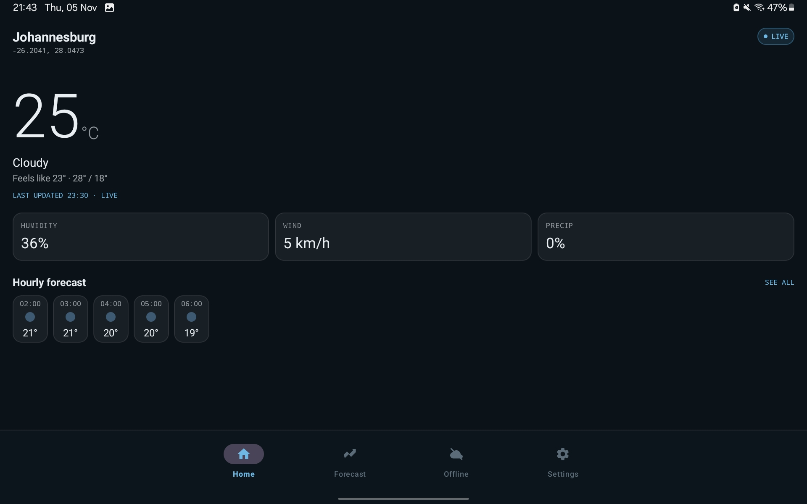
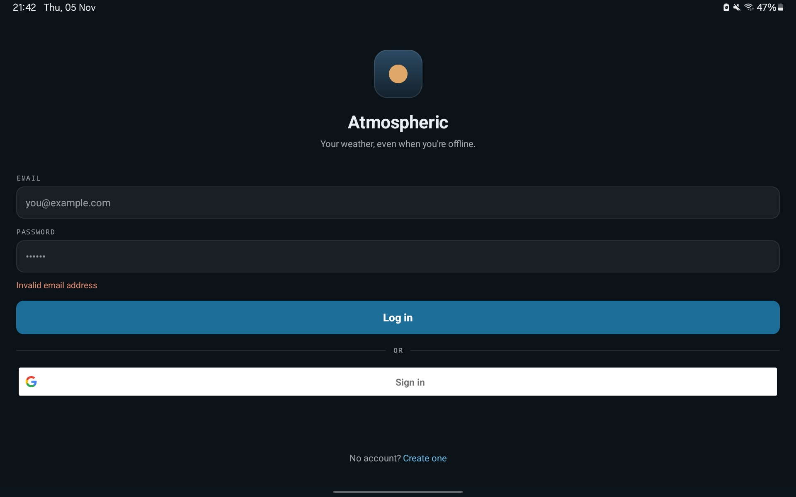
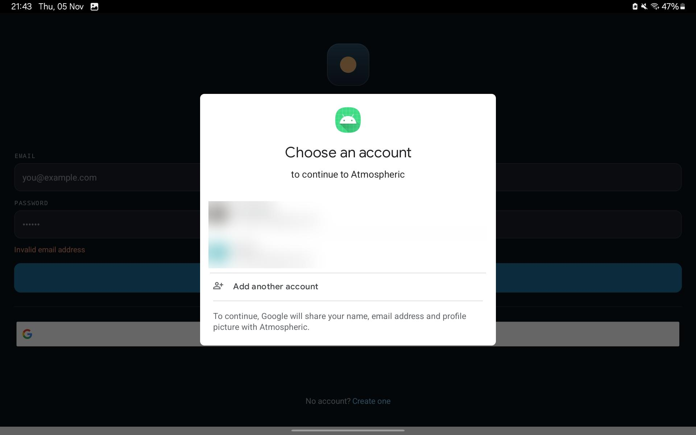
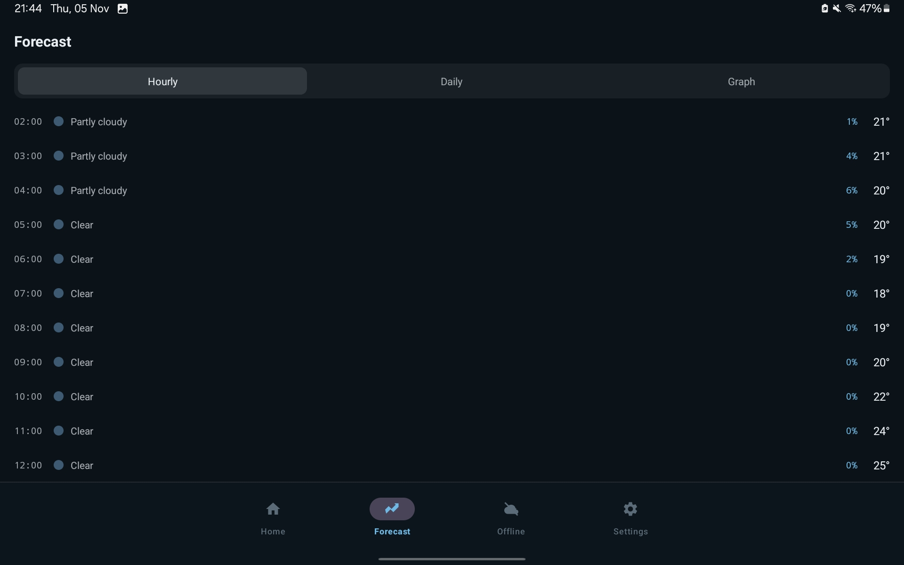
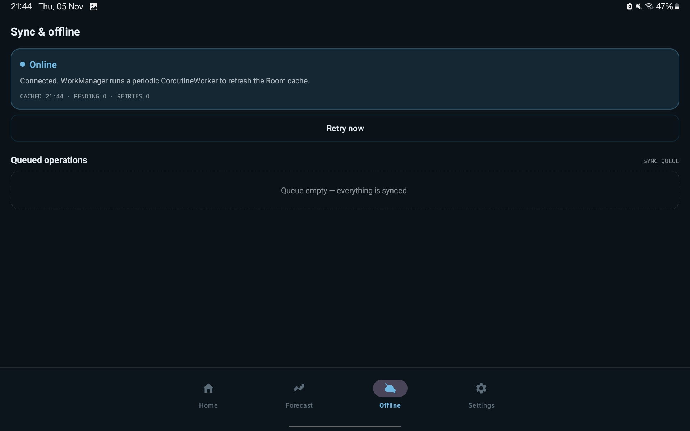
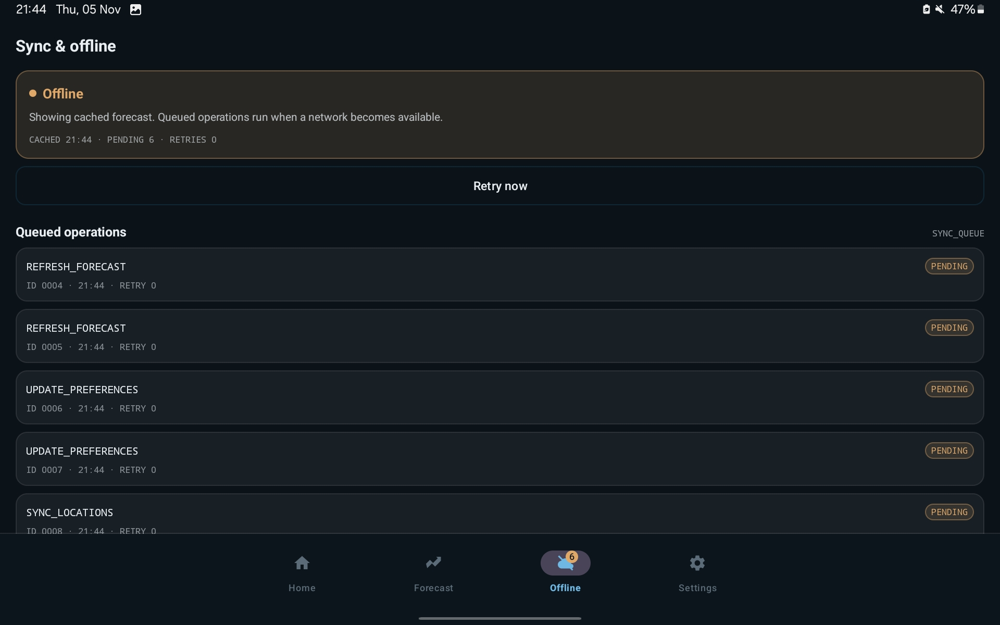
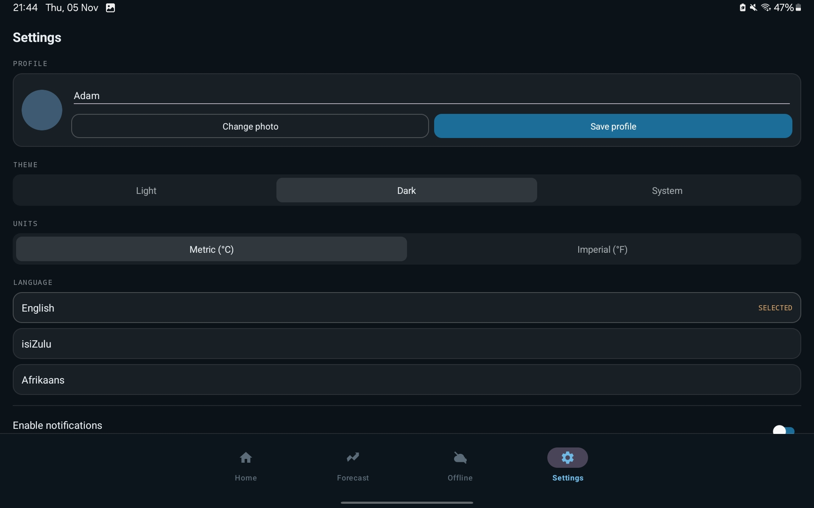
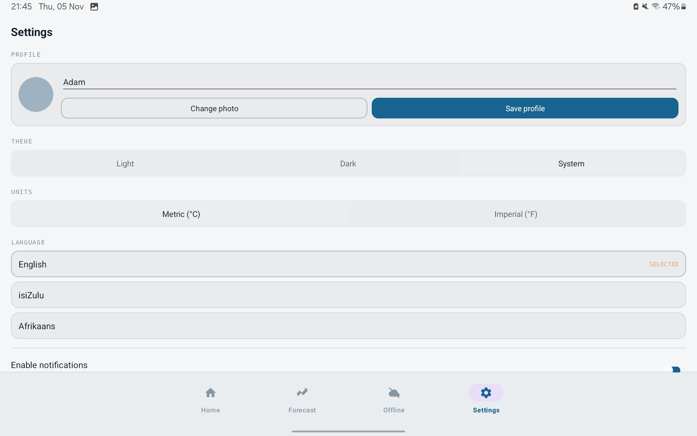
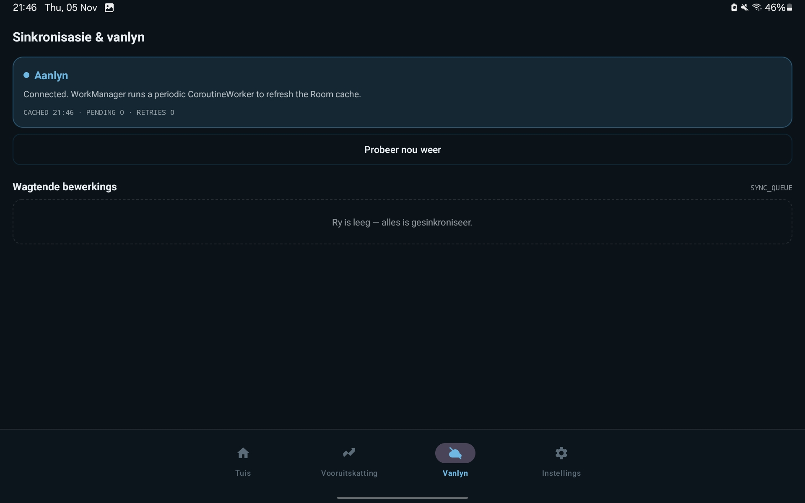

# Atmospheric

**OPSC6312 — Group 24 | Part 3 Final Portfolio of Evidence**

Your weather, even when you're offline.

Atmospheric is an Android weather forecasting application designed to provide live weather updates, offline access, secure authentication and personalised settings.

**Final Demonstration Video:** https://youtu.be/EmGvdpIsu-I

**GitHub Repository:** https://github.com/ST10443034/atmospheric

[](https://github.com/ST10443034/atmospheric/actions/workflows/blank.yml)

---

## Table of Contents

1. [Final Demonstration](#final-demonstration)
2. [Application Screenshots](#application-screenshots)
3. [Purpose of the Application](#purpose-of-the-application)
4. [Features and Requirements](#features-and-requirements)
5. [Design and Architecture](#design-and-architecture)
6. [Database and API Integration](#database-and-api-integration)
7. [GitHub and Automated Testing](#github-and-automated-testing)
8. [Release Notes](#release-notes)
9. [Publishing Preparation](#publishing-preparation)
10. [Installation](#installation)
11. [Team Members](#team-members)

## Final Demonstration

[Watch our Atmospheric Final Part 3 Video](https://youtu.be/EmGvdpIsu-I)

The video demonstrates the application interface, login and registration, weather dashboard, forecast views, settings, language switching and offline functionality.

## Application Screenshots

### Live Weather Dashboard



Displays Johannesburg weather information, temperature, humidity, wind speed, precipitation and hourly forecasts. The LIVE indicator identifies newly retrieved weather data.

### Login Validation and Google Sign-In

| Login Validation | Google Account Selection |
|---|---|
|  |  |

The login screen validates email input and provides an alternative Google account selection flow through Firebase Authentication.

### Forecast Information



The hourly forecast shows predicted temperatures, weather conditions and precipitation percentages. Users can also navigate to daily and graphical forecast views.

### Offline Functionality and Synchronisation

| Online | Offline |
|---|---|
|  |  |

The online screen shows a cleared sync queue. The offline screenshot demonstrates six pending operations, including forecast refreshes, preference updates and location synchronisation requests.

### Settings and Personalisation

| Dark Theme | Light Theme |
|---|---|
|  |  |

Users can choose between light, dark and system themes, change measurement units, edit profile information and manage notifications.

### Afrikaans Language Support



Atmospheric supports English, isiZulu and Afrikaans. The screenshot demonstrates Afrikaans navigation labels and synchronisation controls.

## Purpose of the Application

Atmospheric was developed to make weather information accessible even when internet connectivity is unreliable. It retrieves forecasts from Open-Meteo and uses a Room database to cache weather information locally. A LIVE or CACHED indicator helps users understand whether the displayed information is current or saved.

## Features and Requirements

| Feature | Implementation |
|---|---|
| Registration and login | Firebase Authentication using email and password |
| Single sign-on | Google Sign-In integrated with Firebase |
| Profile and settings | Profile name, photo, theme, units and language preferences |
| REST API | Retrofit and Gson integration with Open-Meteo |
| Offline mode | Room database and synchronisation queue |
| Notifications | Firebase Cloud Messaging and local weather alerts |
| Multilingual support | English, isiZulu and Afrikaans |
| NoSQL database | Cloud Firestore stores user profiles and preferences |
| Profile image data | Compressed Base64 photo data stored in Firestore |
| Application assets | Adaptive Android launcher icon and interface resources |

**Evidence note:** Screenshots demonstrate visible application behaviour. Separate testing is needed to verify completed cloud writes, notification delivery and the processing of queued operations after reconnection. Storing Base64 images in Firestore is not equivalent to a dedicated object-storage service.

## Design and Architecture

Atmospheric follows the Model-View-ViewModel (MVVM) architecture, separating the user interface from application logic and data management.

- **Kotlin and Android Studio:** Android development.
- **XML layouts and view binding:** User interface.
- **Firebase Authentication:** Account registration and login.
- **Cloud Firestore:** NoSQL profile and preferences storage.
- **Room Database:** Local weather caching.
- **Retrofit and Gson:** REST API communication.
- **WorkManager:** Background synchronisation.
- **DataStore:** Local settings persistence.
- **Firebase Cloud Messaging:** Push notification integration.

### Data Flow

```text
Open-Meteo REST API
        |
      Retrofit
        |
 Weather Repository
        |
    Room Database
        |
      ViewModel
        |
    Android UI
```

## Database and API Integration

### Firebase Authentication

Firebase Authentication manages registered users and authentication providers. Passwords are handled by Firebase rather than saved in plaintext within the application.

### Cloud Firestore

The users collection stores information such as:

- Display name
- Email
- Preferred language
- Theme
- Measurement units
- Notification preferences
- Profile photo data
- Firebase Cloud Messaging token

Each user has an individual profile document identified by their Firebase user ID.

### Open-Meteo API

The Open-Meteo REST API supplies weather data, including temperature, conditions, humidity, wind speed and forecasts.

### Offline Storage

Room stores cached weather information on the device. When the network is unavailable, the app can display saved information and queue supported operations for later processing.

## GitHub and Automated Testing

GitHub was used for version control, collaboration and source-code management.

### GitHub Actions

The project includes automated Android workflows:

- [Android CI Workflow](.github/workflows/blank.yml)
- [Release Workflow](.github/workflows/release.yml)

The CI workflow compiles the application, runs Android Lint and unit tests, builds a debug APK and uploads build artifacts.

### Automated Tests

The project contains application-specific tests for:

- Unit conversion
- Severe-weather alert rules
- Profile image processing

### Continuous Integration

Automated builds help identify compilation problems and test failures whenever project changes are submitted.

[View GitHub Actions](https://github.com/ST10443034/atmospheric/actions)

## Release Notes

### Atmospheric Version 2.0 — Final PoE

#### Added Features

- Google Sign-In integration
- Cloud Firestore profile management
- Offline operation queue and background synchronisation
- Severe-weather alert functionality
- Profile photo selection and storage
- Multilingual interface support
- Light, dark and system theme options

#### Improvements

- Temperature and wind unit conversion
- Clearer LIVE and CACHED weather indicators
- Improved account validation and error messages
- Enhanced weather forecast presentation
- Application-specific automated unit tests
- GitHub Actions build and release workflows

#### Known Limitations

- Johannesburg remains the default weather location.
- Some forecast information may not be fully available offline.
- Translations require additional language review.
- Final Play Store compatibility and publication requirements must be verified.

## Publishing Preparation

**Application ID:** com.group24.atmospheric

**Version:** 2.0

**Version Code:** 2

**Minimum SDK:** 26

**Current Target SDK:** 34

The project contains an adaptive launcher icon and release-build configuration. Google Play publication readiness requires reviewing the latest target SDK requirements, signing, Android App Bundle output and store listing assets.

## Installation

### Build from Source

1. Clone the repository.
2. Open the project in Android Studio.
3. Configure the required Firebase project.
4. Synchronise Gradle.
5. Build and run the application on an Android device.

### Gradle Commands

```bash
./gradlew assembleDebug
./gradlew build
./gradlew test
./gradlew assembleRelease
```

### APK

A Version 2.0 release APK is included in the repository:

[Atmospheric Version 2.0 APK](Atmospheric-v2.0-release.apk)

## Team Members

| Student Number | Name |
|---|---|
| ST10443034 | Oluga Jeffrey Neluvhalani |
| ST10446457 | Luthando Mndawe |

---

**Atmospheric — OPSC6312 Group 24 Final Portfolio of Evidence**
